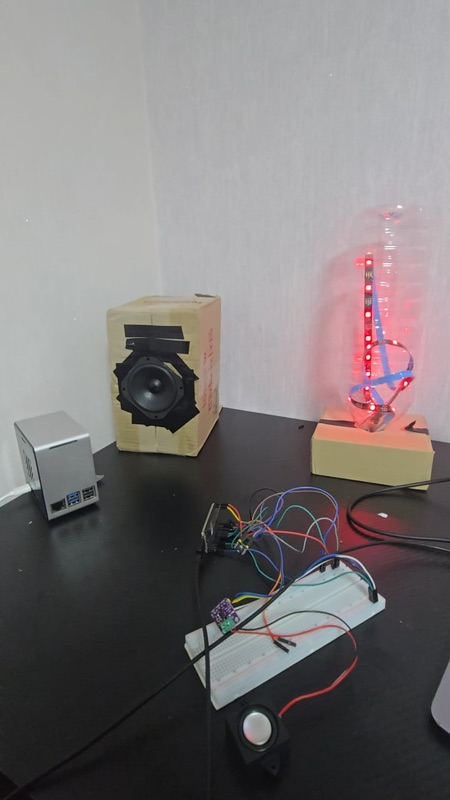
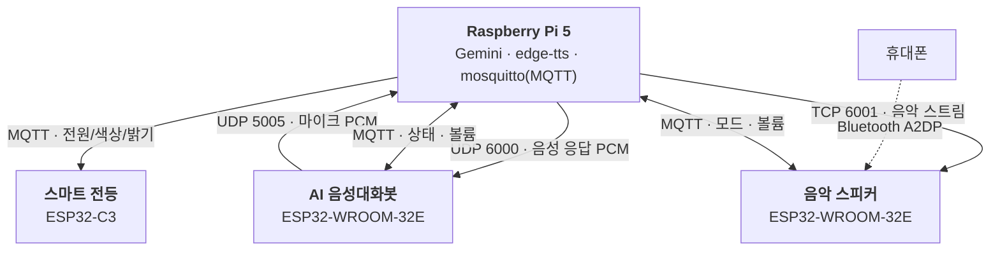
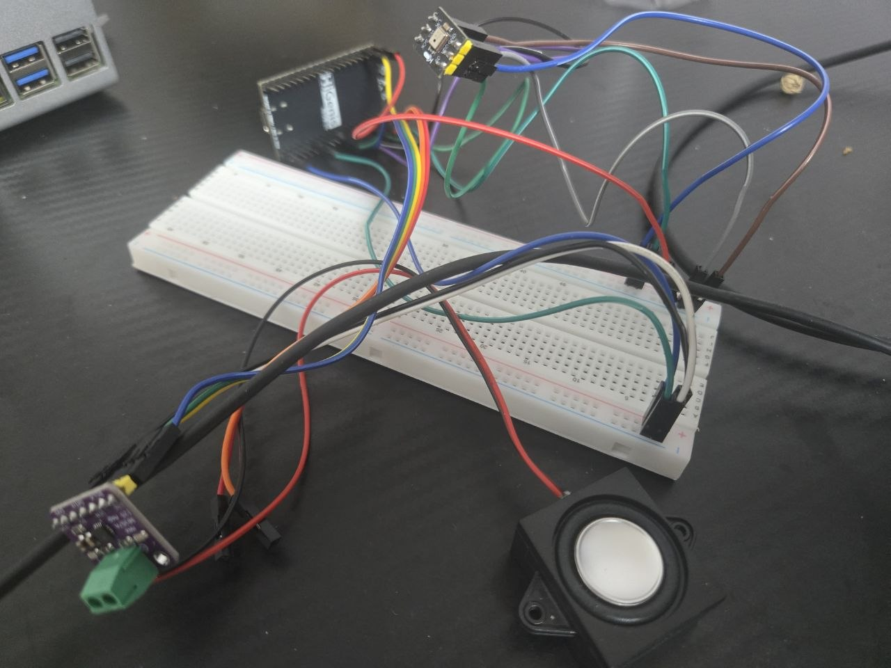
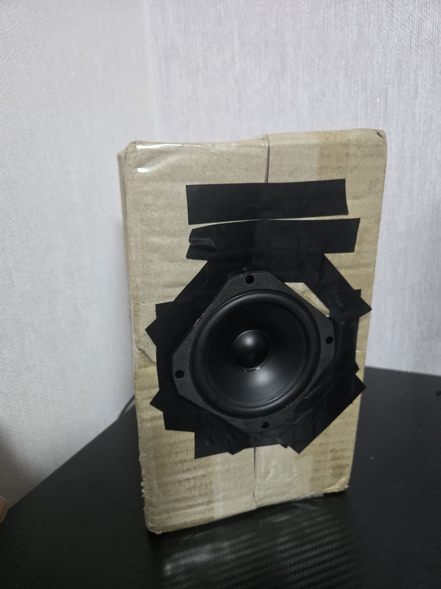
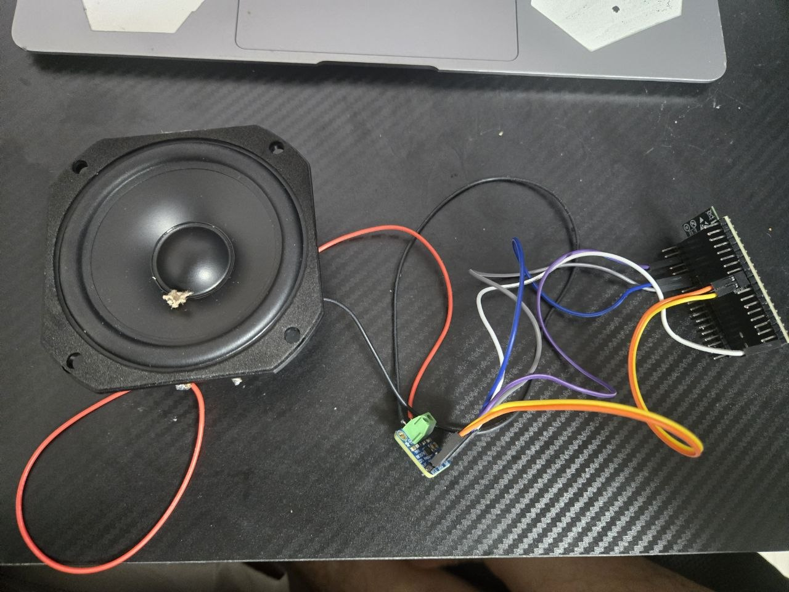
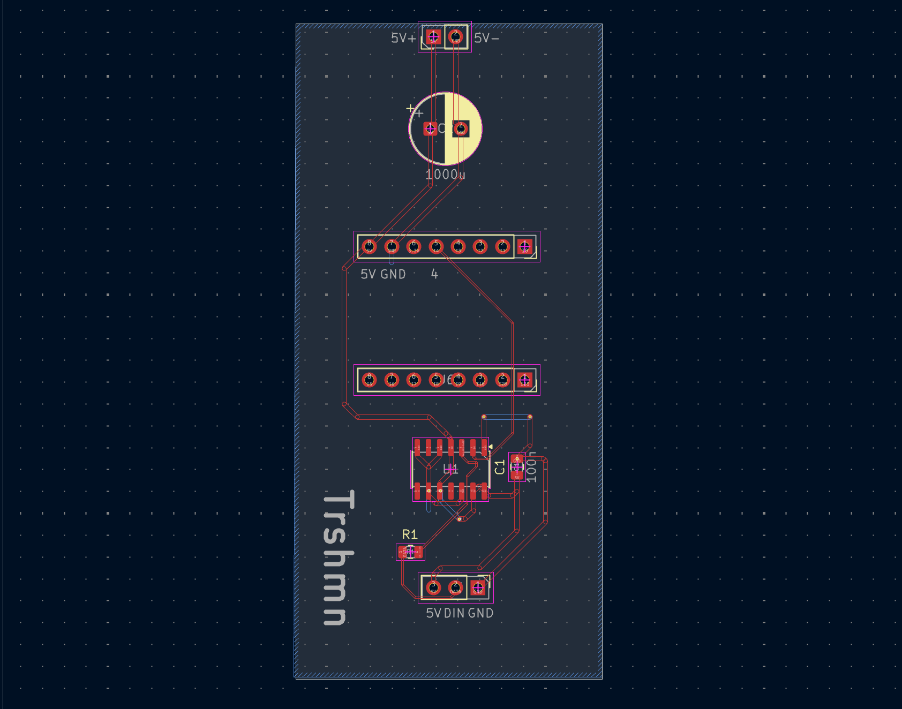
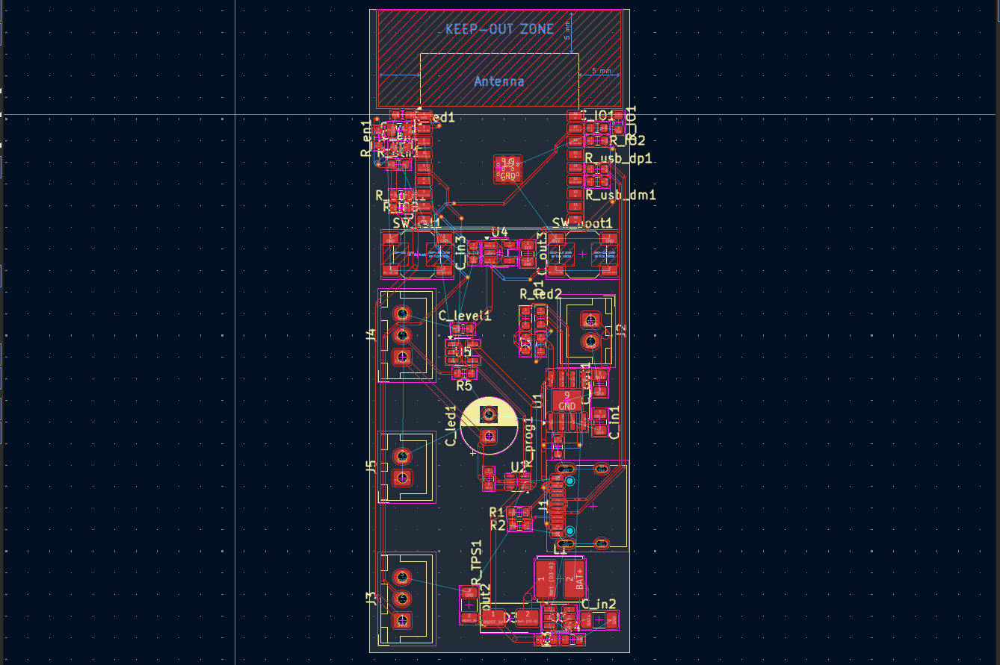

# 스마트홈 IoT 시스템

라즈베리파이 5를 두뇌로, **AI 음성대화봇 · 음악 스피커 · 스마트 전등** 세 기기가 하나의 시스템으로 동작합니다.
무거운 판단(음성인식 · LLM · TTS)은 Pi가, 입출력은 각 기기의 ESP32가 맡도록 역할을 나눴습니다.

<p align="center">
  
</p>

## 시스템 구성



| 데이터 | 방식 | 이유 |
|---|---|---|
| 상태 전환 · 제어 명령 | **MQTT** | 작고 가벼운 메시지 |
| 짧은 음성 (마이크 · 응답) | **UDP** | 지연이 적음 |
| 긴 음악 스트림 | **TCP** | 손실 없이 순서 보장 |

## 폴더 구조

```
firmware/
├── voice_bot/       AI 음성대화봇 (Arduino)
├── music_speaker/   Wi-Fi · Bluetooth 음악 스피커 (Arduino)
└── smart_lamp/      스마트 전등 (ESP-IDF)
server/              라즈베리파이 코드 (Python)
hardware/
├── lamp_v1/         전등 PCB v1 — KiCad 원본, 거버, BOM, CPL
└── lamp_v2/         전등 PCB v2 (진행 중) — KiCad 원본
docs/images/         사진 · 회로도 · PCB 이미지
```

---

## 1. AI 음성대화봇 — `firmware/voice_bot`

- ESP32는 마이크 · 스피커 입출력만, Pi는 음성인식 · LLM · TTS를 담당
- 상태(`idle` · `listening` · `thinking` · `speaking` · `playing_music`)는 MQTT, 음성은 **16-bit / 16kHz mono PCM**을 UDP로 전송
- **RMS 기반 VAD**로 말할 때만 전송. 음악이 재생 중이면 역치를 높여 음악 소리를 무시
- 응답 재생 중(+300ms)에는 녹음하지 않아 자기 목소리를 명령으로 인식하지 않음

| 부품 | 연결 (ESP32 GPIO) |
|---|---|
| INMP441 마이크 (I2S) | SCK 32 · WS 33 · SD 34 |
| MAX98357A 앰프 (I2S) | BCLK 26 · LRC 25 · DIN 22 |
| 스피커 | 8Ω 3W |



## 2. Wi-Fi · Bluetooth 음악 스피커 — `firmware/music_speaker`

- 대화 응답과 음악이 한 스피커에서 충돌하지 않도록 **기기를 분리**
- **Wi-Fi 모드**: Pi의 음악을 TCP로 수신 (44.1kHz 스테레오) / **Bluetooth 모드**: 휴대폰과 직접 연결
- 모드 전환: BOOT 버튼 1초 또는 MQTT `music/mode` ← `bt` / `wifi`

| 부품 | 연결 (ESP32 GPIO) |
|---|---|
| MAX98357A 앰프 (I2S) | BCLK 26 · LRC 25 · DIN 22 |
| 모드 전환 버튼 | BOOT (GPIO 0) |

 

## 3. 스마트 전등 — `firmware/smart_lamp`

- 18650 배터리로 동작하는 무선 전등. **PCB를 KiCad로 직접 설계**하고 JLCPCB에서 제작
- Arduino → **ESP-IDF**로 이전, MQTT 토픽 세 개로 전원 · 색상 · 밝기 제어
- 제어 함수를 Pi 쪽 `server/lamp/core.py`로 모아 Gemini · 알람 · (향후) 앱이 같은 함수를 호출
- 원하는 시간에 켜고 끄는 알람 예약 (APScheduler, cron 방식)

| 항목 | 내용 |
|---|---|
| MCU | ESP32-C3 |
| LED | WS2812B 30구 · GPIO 4 · RMT 제어 |
| 전원 | 18650 셀 · 5V 부스트 |
| 레벨 시프터 | 74AHCT125 (3.3V → 5V) |

### PCB v1 → v2

| | v1 (제작 완료) | v2 (아트웍 진행 중) |
|---|---|---|
| PCB |  |  |
| MCU | 개발보드를 꽂아서 사용 | ESP32-C3-WROOM-02 모듈 직접 실장 |
| 전원 | 외부 부스트 모듈 사용 | 충전(TP4056) · 부스트(MT3608) · LDO(ME6211) 내장 |
| 레벨 시프터 | 74AHCT125 (4채널) | 74AHCT1G125 (1채널) |
| LED 전원 | 항상 공급 | 로드 스위치(TPS22919)로 펌웨어가 켜고 끔 |
| 펌웨어 업로드 | 개발보드 USB | ESP32-C3 내장 USB (USB-C) |

회로도: [v1](docs/images/lamp_v1_schematic.png) · [v2](docs/images/lamp_v2_schematic.png)

---

## MQTT 토픽

| 토픽 | 값 | 보내는 쪽 → 받는 쪽 |
|---|---|---|
| `lamp/power` | `on` / `off` | Pi → 전등 |
| `lamp/brightness` | `0` ~ `100` | Pi → 전등 |
| `lamp/color` | `[r, g, b]` 또는 `r,g,b` | Pi → 전등 |
| `device/state` | `idle` / `thinking` / `speaking` … | Pi → |
| `music/state` | `playing` / `stopped` | Pi → 음성대화봇 (VAD 역치 조절) |
| `speaker/volume` | `0` ~ `100` | → 음성대화봇 |
| `music/volume` | `0` ~ `100` | → 음악 스피커 |
| `music/mode` | `bt` / `wifi` | → 음악 스피커 |

---

## 트러블슈팅

### 마이크에 잡음만 들어오는 문제 (음성대화봇)
- **문제**: 한 보드에 마이크와 스피커(앰프)를 함께 배선하자 마이크 입력에 "지지직" 잡음만 들어옴
- **확인**: 멀티미터로 각 부품의 전압을 측정하며 하나씩 정상 동작을 확인
- **해결**: 마이크와 스피커(앰프)의 GND 선을 분리해 연결 → 잡음 해결

### Wi-Fi · Bluetooth 동시 사용 시 용량 부족 (음악 스피커)
- **문제**: Wi-Fi와 Bluetooth 오디오를 동시에 쓰기엔 ESP32의 용량이 부족
- **해결**: 두 모드로 나누고, Bluetooth 사용 중에는 Wi-Fi 오디오를 끄도록 전환 설계

### ESP32-C3는 클래식 Bluetooth 미지원 (음악 스피커)
- **문제**: 휴대폰 음악을 받으려면 클래식 Bluetooth(A2DP)가 필요한데 ESP32-C3는 미지원
- **해결**: 클래식 Bluetooth를 지원하는 ESP32-WROOM-32E 선택

### ESP-IDF 전환 후 Wi-Fi 연결 실패 (스마트 전등)
- **문제**: Arduino에서는 잘 되던 Wi-Fi가 ESP-IDF로 옮기자 연결 실패 (인증 타임아웃)
- **확인**: ESP32-C3 저가 보드에서 송신(TX) 출력이 너무 강해 같은 문제가 생기는 사례 확인
- **해결**: 송신 출력을 낮춰 연결 안정화 (34 × 0.25dBm = 8.5dBm)
  ```c
  ESP_ERROR_CHECK(esp_wifi_set_max_tx_power(34));
  ```

---

## 빌드 · 실행

### 공통: 비밀 정보 설정
Wi-Fi · MQTT 계정과 API 키는 GitHub에 올리지 않습니다. 각 폴더의 예시 파일을 복사해 값을 채우세요.

| 위치 | 복사할 파일 → 만들 파일 |
|---|---|
| `firmware/voice_bot/` | `secrets.example.h` → `secrets.h` |
| `firmware/music_speaker/` | `secrets.example.h` → `secrets.h` |
| `firmware/smart_lamp/main/` | `secrets.example.h` → `secrets.h` |
| `server/` | `.env.example` → `.env` |

### 음성대화봇 · 음악 스피커 (Arduino IDE)
- 보드: ESP32-WROOM-32E 개발보드 (**Arduino ESP32 core 3.x**)
- 라이브러리: `PubSubClient`, 음악 스피커는 추가로 `ESP32-A2DP`
- 음악 스피커는 **Tools → Partition Scheme → Huge APP (3MB No OTA)** 필요

### 스마트 전등 (ESP-IDF v5.3.1)
```bash
cd firmware/smart_lamp
idf.py set-target esp32c3
idf.py build flash monitor
```
MQTT 브로커 주소는 `idf.py menuconfig` → **Example Configuration → Broker URL**에서 설정합니다.

### 라즈베리파이 서버 (Python 3.13)
```bash
sudo apt install mosquitto ffmpeg
cd server
python -m venv .venv && source .venv/bin/activate
pip install -r requirements.txt
set -a; source .env; set +a      # .env 의 값을 환경변수로 불러오기
python assistant.py
```
ESP32 기기들의 IP 주소는 `server/audio_client.py` 상단의 `VOICE_IP`, `MUSIC_IP`에 입력합니다.

---

## 앞으로 할 일
- [ ] 전등 PCB v2 아트웍 완료 및 제작
- [ ] 휴대폰 앱에서 전등 제어 (Pi `lamp/core.py` 함수 재사용)
